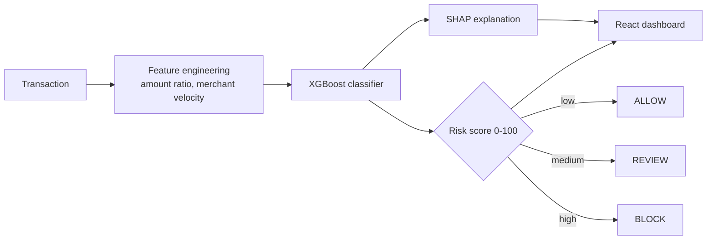

<!-- HEADER BANNER -->


<!-- TYPING ANIMATION -->
<div align="center">
  <a href="https://github.com/ramritheesh">
    
  </a>
</div>

<br>

<!-- CONTACT BADGES -->
<p align="center">
  <a href="https://www.linkedin.com/in/k-v-ram-ritheesh"></a>
  <a href="mailto:ram123ritheesh@gmail.com"></a>
  
  
</p>

---

## 👨💻 About Me

<table>
<tr>
<td width="55%" valign="top">

```python
class RamRitheesh:
    def __init__(self):
        self.role      = "AI/ML Engineer (in the making)"
        self.studying  = "B.Tech, Robotics and AI @ BIT"
        self.cgpa      = 8.63
        self.location  = "Bengaluru, India"
        self.loves     = ["ML pipelines", "LLM apps",
                          "Explainable AI", "Clean APIs"]
        self.looking_for = "AI/ML internship"

    def mission(self):
        return "Turn messy data into models people can trust."
```

</td>
<td width="45%" valign="top">

🔭 **Building:** LLM, RAG and fraud-detection systems

🧪 **Obsessed with:** model evaluation and explainability

⚙️ **Strength:** end-to-end, from SQL and models to APIs and UI

🎯 **Goal:** ship production-ready AI at a product team

</td>
</tr>
</table>

---

## 🧰 Tech Arsenal

<p align="center">
  
</p>

<p align="center">
  
  
  
  
  
  
  
  
  
  
</p>

---

## 🚀 Featured Projects

<table>
<tr>
<td width="50%" align="center">
  <a href="https://github.com/ramritheesh/razorguard">
    
  </a>
</td>
<td width="50%" align="center">
  <a href="https://github.com/ramritheesh/career-os-ai-career-assistant">
    
  </a>
</td>
</tr>
<tr>
<td width="50%" align="center">
  <a href="https://github.com/ramritheesh/ScamShield-AI">
    
  </a>
</td>
<td width="50%" align="center">
  <a href="https://github.com/ramritheesh/ai-insurance-classifier">
    
  </a>
</td>
</tr>
</table>

### 🛡️ RazorGuard: fraud detection that explains itself

> Rule-based fraud limits miss behavioral patterns. RazorGuard scores each transaction against the customer's own history.

| 🎯 ROC-AUC | ⚖️ Threshold | 🔁 Recall | ⚡ Latency |
|:---:|:---:|:---:|:---:|
| **0.9055** | **0.18** (cost-sensitive) | **61.9%** | **< 200 ms** |



<details>
<summary><b>🔍 More project highlights (click to expand)</b></summary>
<br>

**🧭 Career.OS: AI career assistant**
Ranks jobs with a hybrid score: **40% keyword + 60% semantic similarity** (Hugging Face embeddings, cosine similarity). A RAG pipeline powered by Gemini gives personalized career chat, and the "Explain My Match" feature shows skill gaps and strengths. JWT auth with per-user data isolation.
`React` `Node.js` `Express` `MongoDB Atlas` `Gemini API` `RAG`

**🚨 ScamShield AI: digital safety agent**
Paste a suspicious SMS, email or screenshot and get a **0-100 risk score**, a classification and clear next steps. Async FastAPI backend with structured Gemini prompts and multimodal screenshot analysis. API keys stay server-side.
`FastAPI` `Gemini API` `React` `Render` `Vercel`

**📄 InsurAI Classifier: claims triage**
Hybrid NLP and generative AI pipeline that classifies unstructured insurance claim documents and extracts policy entities and triage tags.
`TypeScript` `React` `NLP` `Gemini API`

</details>

---

## 💼 Experience

<details open>
<summary><b>Project Intern · KodNest Technologies</b> &nbsp;|&nbsp; Feb 2026 to May 2026</summary>
<br>

- ⚙️ Built **FastAPI** microservice components with **Pydantic** contracts between services
- 🧹 Automated ingestion validation that filtered malformed inputs with **95% precision**
- 🧪 Wrote **Pytest** unit and regression suites that caught **25+** integration bugs before staging
- 📊 Built Power BI and Excel reports for team leads; documented runbooks and test logs on Git/GitHub

</details>

<details>
<summary><b>🎓 Education and certifications</b></summary>
<br>

- **B.Tech, Robotics and Artificial Intelligence**, Bangalore Institute of Technology (2022 to 2026), **CGPA 8.63/10**
- AI/ML Specialization, **Infosys**
- Introduction to Machine Learning, **NPTEL**
- Full-Stack Web Development, **Internshala**
- AI Foundation Course, **Jio Institute**

</details>

---

## 📊 GitHub Analytics

<p align="center">
  
  
</p>

<p align="center">
  
</p>

---

## 🤝 Let's Connect

<div align="center">

**Hiring for AI/ML, or building something with LLMs? Let's talk.**

[](https://www.linkedin.com/in/k-v-ram-ritheesh)
[](mailto:ram123ritheesh@gmail.com)

*"Models are easy to build. Models people can trust are the real work."*

</div>


